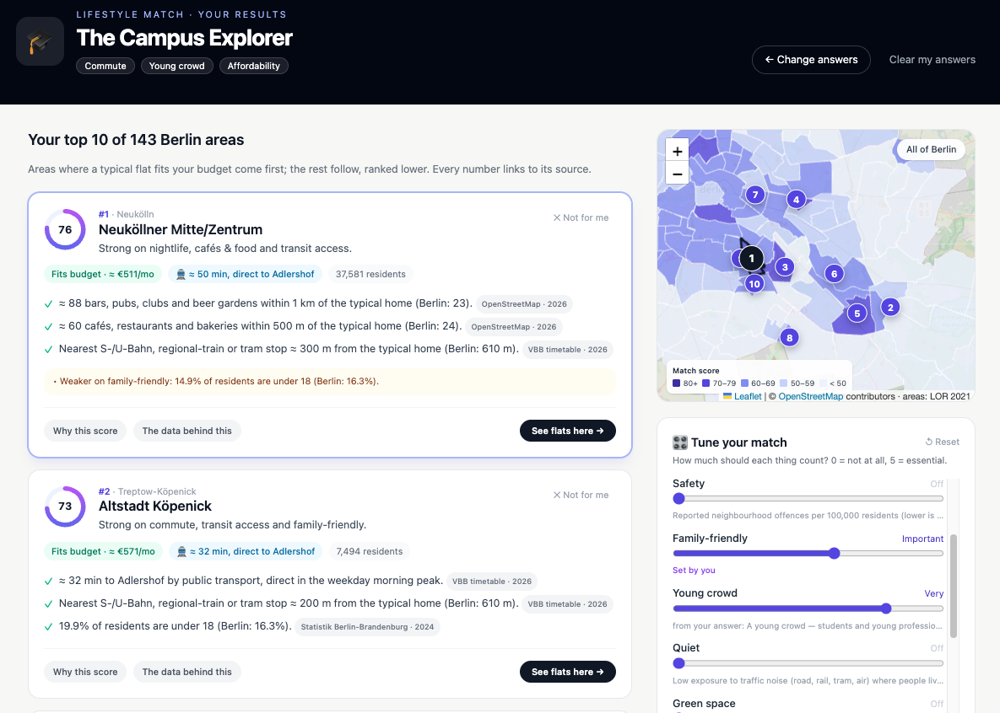
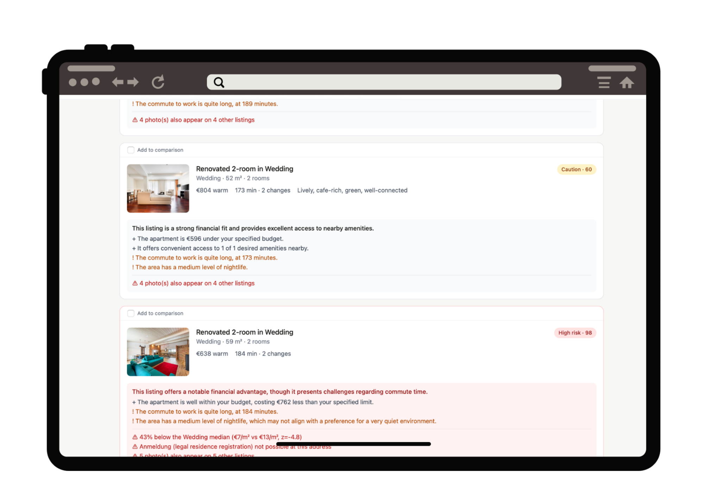

# WohnIQ

**AI-assisted apartment search for Berlin.** Describe what you want in plain language — _"I work near Alexanderplatz, budget €1,500, quiet area, good transport, cafes nearby"_ — and WohnIQ parses it, searches, ranks, explains each match, and flags suspicious listings.

> **Portfolio project.** Listings are synthetic by design — intentionally, so we hold ground-truth scam labels for measurable evals (see [ADR-0003](docs/adr/0003-synthetic-data-and-images.md)). The goal is to demonstrate production-grade AI engineering: reliable structured LLM output, clean language-vs-logic separation, a measurable scam detector, tests, evals, and a deployable system.

Live: https://wohniq-plum.vercel.app
---


## What this project does

Berlin's rental market is scarce, fast-moving, and scam-prone. Traditional portals show you listings but don't help with the *decision*. WohnIQ's bet: the value isn't fancier filters, it's an AI reasoning layer on top of good data — one that synthesizes commute, neighborhood, budget fit, and risk into an explained recommendation.

**Primary flow:**
1. User types a natural-language query.
2. Gemini Flash parses it into a validated `SearchCriteria` object (budget, rooms, work location, amenities, etc.).
3. Hard constraints filter the listing DB; pgvector cosine search surfaces semantically relevant candidates.
4. A deterministic scoring function ranks results by commute fit, budget fit, neighborhood match, and amenity match.
5. Real-time enrichment fetches public-transport commute times (BVG/VBB API) and POI counts (OSM Overpass).
6. A hybrid scam engine runs on every listing: price z-score, pHash duplicate detection, and an LLM text pass produce a fused 0–100 risk score with evidence.
7. Results render as cards with a natural-language explanation grounded in the score breakdown, a risk badge, and a neighborhood map.
8. Users can select 2–4 listings for a side-by-side comparison.

### Lifestyle Match — find your Kiez, not just a flat

Not everyone knows which neighbourhood to search in. **Lifestyle Match** (`/lifestyle`) asks a few playful questions (or starts from a preset like 🎓 Student or 🌳 Calm & green). It predicts your lifestyle persona, lets you confirm it, and ranks **all 143 Berlin areas** with a transparent, deterministic score built from official and open data: police crime statistics, the population register, the environmental atlas, IBB rents, the VBB timetable and OpenStreetMap. Every suggestion explains *why*, with the source of each number. You can re-weight factors, remove areas, update the ranking and open WohnIQ listings located in an area. **Your answers are never stored or logged.**



→ Full write-up, data sources, scoring, evaluation and privacy guarantees: [`docs/LIFESTYLE_MATCH.md`](docs/LIFESTYLE_MATCH.md)

---

## Key architectural decisions

The architecture reflects a single principle: **LLMs handle language; code handles logic.** Here's how that played out in practice.

### ADR-0001 — Ranking is deterministic; the LLM never scores or orders

The tempting shortcut is to hand the model a list of listings and ask it to rank them. We rejected this: LLMs are inconsistent at ordering, unreliable at arithmetic, and produce opaque reasoning. Instead, ranking is a pure, weighted scoring function in code — same input always produces the same output. The LLM's roles are limited to three single-shot calls: parse a query, read fuzzy scam text, write an explanation from an already-computed breakdown.

This decision is load-bearing for everything else. Because ranking is deterministic, explanations are trustworthy (they're generated *from* the same numbers that produced the rank). Because the LLM is stateless, we don't need an agent framework. [→ ADR-0001](docs/adr/0001-deterministic-ranking.md)



### ADR-0002 — Scam detection is a hybrid rules + pHash + LLM engine

A pure LLM classifier ("is this a scam?") would be opaque, inconsistent, and unconvincing in a demo. Instead, the risk engine fuses three signal sources into an explained 0–100 score:

1. **Deterministic rule signals (€0):** price z-score vs. Kiez+size median; metadata rules (off-platform contact, no-Anmeldung clauses, etc.).
2. **Image signals (local pHash, €0):** perceptual-hash duplicate detection across the listing DB catches reused/stolen photo sets.
3. **LLM text pass (`scam_text.v1`):** extracts fuzzy language signals (urgency, landlord-abroad, payment pressure) as *validated structured output with verbatim evidence quotes* — not a verdict.

The fusion step emits contributing signals with their evidence, so the UI can show exactly *why* a listing was flagged. This "explainable by construction" design is the single best demo screenshot. [→ ADR-0002](docs/adr/0002-hybrid-scam-detection.md)

### ADR-0003 — Synthetic listings with hotlinked stock photos

Real listings drag in legal, privacy, and freshness problems irrelevant to a portfolio project — and, critically, don't give us ground-truth scam labels. We generate ~100 synthetic listings with realistic Berlin distributions (Kieze, rents per m², sizes), including a labeled ~15% scam subset spanning four scam types plus hard negatives (cheap-but-legit, landlord-travels-but-legit). Photos are sourced via the Pexels API by room type and hotlinked (zero storage). The seeder deliberately reuses photo sets across scam listings to create realistic duplicate-photo fraud. [→ ADR-0003](docs/adr/0003-synthetic-data-and-images.md)


### ADR-0004 — Gemini Flash with validated structured output via a central LLM client

Reliability risk with LLMs is not capability but *boundary integrity*: free-form text breaks downstream code. Every Gemini call goes through a central client (`core/llm.py`) that: requests JSON constrained to a Pydantic model, validates the response, re-prompts once on failure, then falls back to a deterministic path (keyword extractor for parsing, rules-only for scam, template for explanation). No unvalidated model text reaches business logic or the user. The client logs prompt id, token counts, latency, and validation result for observability. [→ ADR-0004](docs/adr/0004-gemini-structured-output.md)


### ADR-0005 — Supabase Postgres + pgvector

One free service covering relational data, vector similarity search, and storage. pgvector keeps semantic search inside Postgres — simpler, one query path, credible production story. Cold-start risk (free-tier projects pause after ~1 week) is mitigated by a GitHub Actions cron keep-alive. [→ ADR-0005](docs/adr/0005-supabase-postgres-pgvector.md)

### ADR-0006 — SQLAlchemy 2.0 + Alembic, with raw SQL for vector/ranking queries

Typed `Mapped[...]` models are the single source of truth for the schema; Alembic handles migrations. But the ORM is not used everywhere — pgvector similarity search and ranking queries stay raw SQL (`text()`), because that's where the ORM abstraction fights clarity. Knowing *where not* to use the ORM is part of the decision. [→ ADR-0006](docs/adr/0006-orm-sqlalchemy-alembic.md)

### ADR-0007 — Direct provider SDK over LangChain / LangGraph

WohnIQ's LLM usage is three stateless, single-shot calls. LangGraph is an orchestration framework for stateful, cyclic, multi-actor agent workflows — using it here would be over-engineering. We call the Gemini SDK directly, behind a thin injectable client. Provider portability is achieved by an injectable `transport` boundary in ~10 lines — no framework dependency, readable reliability logic, and easy to swap later. [→ ADR-0007](docs/adr/0007-direct-sdk-over-agent-framework.md)

### ADR-0010 — Lifestyle Match profiles come from official data, with provenance on every number

Lifestyle Match scores the 143 LOR *Bezirksregionen*, the level where the crime atlas and population register join without estimation. Environmental classes, OSM amenities and VBB transit are aggregated from where residents actually live. Every figure carries `{source, year, method}`. Scores use fixed Berlin-wide reference points, so removing an area never changes another's score. The bundle is rebuilt reproducibly from the raw files (`make lifestyle-data`). [→ ADR-0010](docs/adr/0010-lifestyle-match-data-model.md)

### ADR-0011 — Answers → weights → deterministic, explained ranking (no LLM)

Fixed-choice answers map to 0–5 weights ("max level", explainable per answer). Weights × area scores give the total; over-budget areas are shown but ranked lower. Commute times to 13 fixed destinations are precomputed over the VBB timetable. Explanations and the persona are templates over the same numbers. [→ ADR-0011](docs/adr/0011-lifestyle-match-scoring.md)

### ADR-0012 — Privacy by design

Lifestyle answers are bounded choices (no free text, no addresses). The matching endpoints never touch the database. Logs hold counts only, and answers travel only in POST bodies (`no-store`). The browser keeps them in `sessionStorage` for the tab. The same change redacted user input from `/search`, commute and LLM logs. Tests inject distinctive answers and assert they appear in no log. [→ ADR-0012](docs/adr/0012-privacy-by-design.md)

---

## Stack

| Layer | Tech |
|---|---|
| **Frontend** | Next.js + TypeScript, Tailwind CSS, shadcn/ui, Leaflet + OSM tiles |
| **Backend** | FastAPI, Pydantic, Uvicorn, Docker |
| **AI** | Gemini Flash (`gemini-2.0-flash`) — parsing, scam text, explanations; Gemini `embedding-001` — semantic search |
| **Database** | Supabase Postgres + pgvector |
| **ORM / migrations** | SQLAlchemy 2.0, Alembic |
| **Scam signals** | imagehash (pHash), Pillow |
| **Enrichment** | BVG/VBB `transport.rest` (commute), OSM Overpass (POIs), Nominatim (geocoding) |
| **Images** | Pexels API (hotlinked, attributed in-app) |
| **Deploy** | Backend → Railway (Docker); Frontend → Vercel |
| **Cost** | €0 incremental — Gemini free tier, Supabase free, Railway existing, Vercel free |

---

## Eval results

### Query parser (F1)

Evaluated against 20 canonical queries covering budget-only, location-only, vague vibe queries, and adversarial under-specified inputs.

| Metric | Result |
|---|---|
| Cases fully correct | 20 / 20 (100%) |
| Fields correct | 57 / 57 (100%) |

### Scam detector (F7)

Evaluated against the labeled synthetic set. Precision was the tuning target — avoid crying wolf on cheap-but-legit listings.

| | Predicted scam | Predicted legit |
|---|---|---|
| **Actual scam** | 12 TP | 3 FN |
| **Actual legit** | 2 FP | 83 TN |

| Metric | Result |
|---|---|
| Precision | 86% |
| Recall | 80% |
| F1 | 0.83 |
| Accuracy | 95% |
| Hard negatives cleared | 6 / 8 |

**Recall by scam type:**

| Type | Caught | Recall |
|---|---|---|
| advance_fee | 4 / 4 | 100% |
| overseas_landlord | 4 / 4 | 100% |
| price_bait | 4 / 4 | 100% |
| photo_reuse | 0 / 3 | 0% |

Photo-reuse recall is 0% because pHash matching against hotlinked Pexels URLs requires fetching image bytes, which the test environment does not do. The signal works in production (the seeder fetches bytes at seed time); the eval isolates this as a known gap.

### Lifestyle Match (F9)

Offline and deterministic (`make eval-lifestyle`, also part of `pytest`): **38 / 38 checks pass.**

| Check | Result |
|---|---|
| **Definition of Done:** student preset → area ≤ 20 min from TU Berlin, 30 m² ≤ €700 warm, in the top 3, with reasons | ✅ Schöneberg Nordwest (19 min, ≈ €577) · Otto-Suhr-Allee/Kantstraße (15 min, ≈ €678) |
| 6 more scenarios (HTW student, family, calm & green, remote/creative, young professional, night owl) | ✅ 6 / 6 |
| Determinism · exclusion invariance · budget ordering · grounded explanations (per preset) | ✅ 20 / 20 |
| Monotonicity (raising a weight never demotes the best area for it) | ✅ 7 / 7 |
| Privacy by construction (no free text, unknown fields rejected, fixed destinations, no protected characteristics) | ✅ 4 / 4 |

Plus the log-leak privacy tests, 34 frontend logic tests, and a Playwright end-to-end suite (5 journeys × desktop/mobile). Details: [`docs/LIFESTYLE_MATCH.md`](docs/LIFESTYLE_MATCH.md#5-evaluation--tests).

---

## Repo map

| Path | Purpose |
|---|---|
| [`docs/SPEC.md`](docs/SPEC.md) | Product spec — *what* WohnIQ does, features F1–F8, acceptance criteria |
| [`docs/adr/`](docs/adr/) | Architecture decision records — *why* we chose things |
| [`docs/system_prompts.md`](docs/system_prompts.md) | Versioned product LLM prompts (`parser.v1`, `scam_text.v1`, `explain.v1`) |
| [`AGENTS.md`](AGENTS.md) | Operating manual — conventions, golden rules, working loop |
| [`TASKS.md`](TASKS.md) | Ordered task plan with milestone status |
| `backend/core/llm.py` | Central LLM client with validation, retry, fallback, and observability |
| `backend/search/` | Query parser, retrieval (pgvector), deterministic ranking, explanation |
| `backend/scam/` | Rule signals, pHash duplicate detection, LLM text pass, fusion |
| `backend/enrich/` | Commute (BVG/VBB) and neighborhood (OSM) enrichment, both cached |
| `backend/evals/` | Parser eval harness, ranking sanity eval, scam eval + confusion matrix |
| `frontend/` | Next.js app — search box, result cards, risk badge, comparison, Leaflet map |
| [`docs/LIFESTYLE_MATCH.md`](docs/LIFESTYLE_MATCH.md) | Lifestyle Match — flow, factors, scoring, privacy, evaluation, DoD checklist |
| `backend/lifestyle/` | Lifestyle Match engine: questionnaire, weights, scoring, explanations, persona (pure) |
| `backend/data/lifestyle/` | Region profile build from official data (`make lifestyle-data`) + shipped `regions.json` |
| `backend/app/routers/lifestyle.py` | `/api/v1/lifestyle/*` — catalog, profile, match, listings, region outlines |
| `frontend/app/lifestyle/` | Questionnaire (`/lifestyle`) and results (`/lifestyle/results`) |
| `frontend/tests/`, `frontend/e2e/` | Frontend logic tests (`npm test`) and Playwright journeys (`npm run test:e2e`) |

---

## Quickstart

Backend uses [uv](https://docs.astral.sh/uv/). Install it once: `curl -LsSf https://astral.sh/uv/install.sh | sh` (or `brew install uv`).

```bash
# Backend
cd backend
uv sync                       # creates .venv + installs deps
cp ../.env.example ../.env    # fill in GEMINI_API_KEY, DATABASE_URL
uv run alembic upgrade head   # apply schema to Supabase
uv run python -m data.seed_listings
uv run python -m data.seed_images
uv run python -m data.embed_listings
uv run python -m scam.score   # pre-compute risk assessments
uv run uvicorn app.main:app --reload

# Frontend
cd frontend
npm install
npm run dev

# Evals
cd backend
uv run python -m evals.parser_eval   # or: make eval-parser
uv run python -m evals.ranking_eval  # or: make eval-ranking
uv run python -m evals.scam_eval     # or: make eval-scam
uv run python -m evals.lifestyle_eval  # or: make eval-lifestyle (offline)

# Lifestyle Match
make lifestyle-data                  # rebuild region profiles from the raw official files (~4 min)
cd frontend && npm test              # frontend logic tests (no extra deps)
cd frontend && npm run test:e2e      # Playwright journeys (first: npx playwright install chromium)
```

From the repo root: `make install`, `make dev`, `make test`, `make lint`.

### Offline demo mode

Runs the whole app with **no database and no external APIs** (no Supabase, Gemini,
BVG/VBB, or Overpass). Which mode the backend runs in (first match wins):

| `WOHNIQ_DEMO` | `DATABASE_URL` | Mode |
|---|---|---|
| `1` | set or empty | **demo**: the URL is ignored and no DB connection is opened |
| `0` or empty/unset | empty (e.g. no `.env`) | **demo**: there is no database to use |
| `0` or empty/unset | set | **live** |

`WOHNIQ_DEMO` accepts `1/0`, `true/false`, `yes/no`, `on/off`; any other value stops the
backend at startup rather than silently running live. The startup log prints the mode and
why, and `/api/v1/health` reports `"mode": "demo"` or `"live"`. A variable exported in the
shell beats `.env`, so `make demo` (which sets `WOHNIQ_DEMO=1`) works with a full `.env`.
This only affects the API server: CLI scripts (`make migrate`, `make seed`, `export_demo_data`)
always use `DATABASE_URL`.

```bash
make demo-photos   # once, while online: local copies of listing photos (~141 files)
make demo-stops    # once, while online: VBB stops + weekday-peak network (takes a few minutes)
make demo          # backend on :8000 (WOHNIQ_DEMO=1)
make frontend-dev  # frontend on :3000
```

Data comes from `backend/data/demo/` (exported with `python -m data.export_demo_data`)
plus the deterministic seed-42 generator, so it matches the live database. In offline mode:

- Query parsing and explanations use the deterministic fallbacks (keyword parser, template).
- Semantic search is replaced by keyword overlap with the listing text; hard filters are identical.
- Commute times are **estimated**. After `make demo-stops`, each trip is routed over the VBB
  weekday-peak network (7–9 am): walking, waiting, riding and changes. It's shown as
  "≈25 min · direct · estimated" and weighted 1.5 in ranking instead of 2.0
  ([ADR-0009](docs/adr/0009-route-based-commute-estimate.md)). Without the download, a
  straight-line estimate is used: "≈25 min · estimated", weight 1.0
  ([ADR-0008](docs/adr/0008-offline-commute-estimate.md)). The work location is matched against
  VBB stops and Kiez names; without the download only Kiez names match. Live mode uses the same
  estimates when the transit API fails, instead of showing nothing. `make eval-commute` (online)
  measures both estimates against live journeys.
- Featured listings are drawn from the 38 that have cached neighborhood data, so every card
  opens onto photos, amenities, and a risk rating. Search covers all 100 listings, as live does.
- Without `make demo-photos`, photos load from Pexels if there's internet, otherwise a
  placeholder is shown. Map tiles (OpenStreetMap) always need internet. Without them, the
  listing map switches to a clean background with the 500 m amenity search area, a scale bar and
  a short note; when the connection returns, the tiles reload.

---

## License / attribution

Apartment photos sourced via the Pexels API; attribution shown in-app per their terms.

Lifestyle Match uses derived figures from: Polizei Berlin (Kriminalitätsatlas); Amt für Statistik Berlin-Brandenburg (Einwohnerregisterstatistik, CC BY 3.0 DE; LOR 2021 with SenStadt); Senatsverwaltung für Mobilität, Verkehr, Klimaschutz und Umwelt (Umweltgerechtigkeitsatlas 2023/24); Investitionsbank Berlin (Wohnungsmarktbericht 2025 and Tabellenband); Senatsverwaltung für Stadtentwicklung, Bauen und Wohnen (Betriebskostenübersicht 2026); Moses Mendelssohn Institut; VBB (GTFS open data); and © OpenStreetMap contributors (ODbL 1.0, via Geofabrik). Each figure's source is shown next to it in the app and listed in `backend/data/lifestyle/sources.py`.
