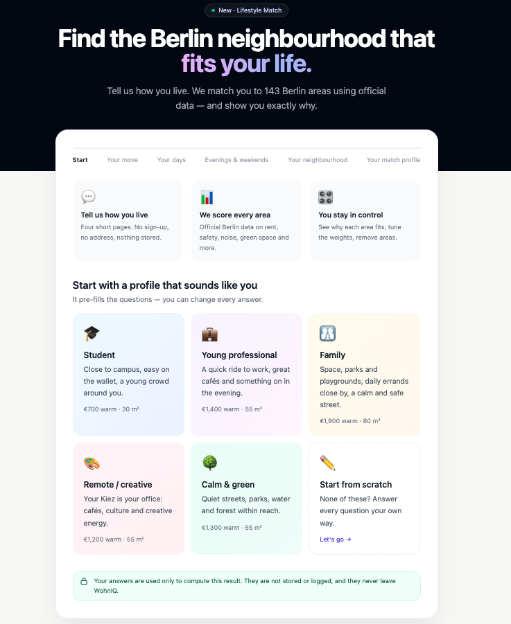
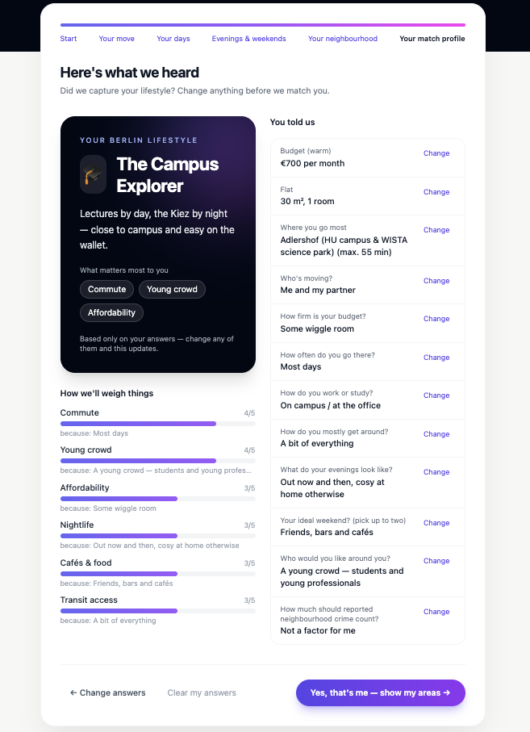
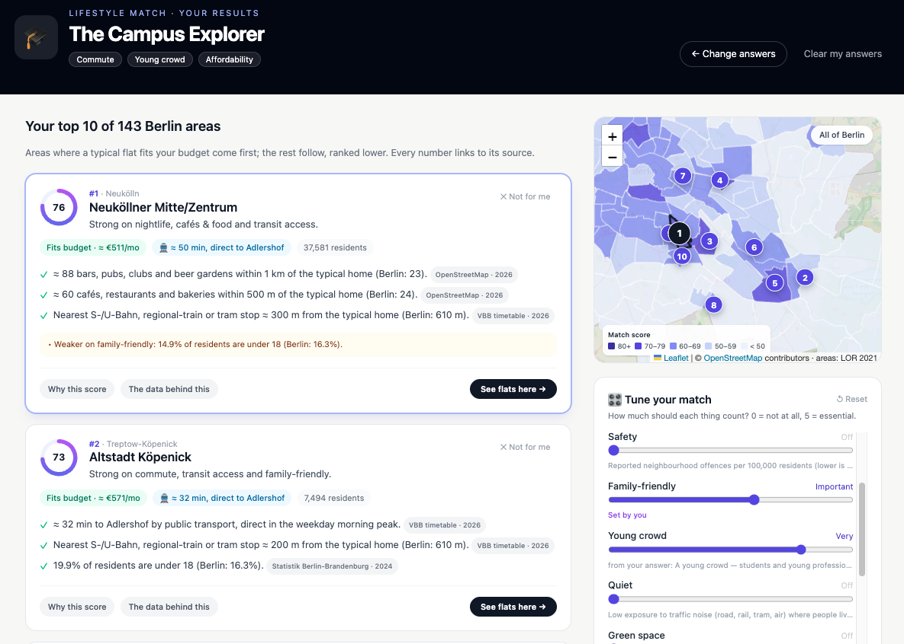
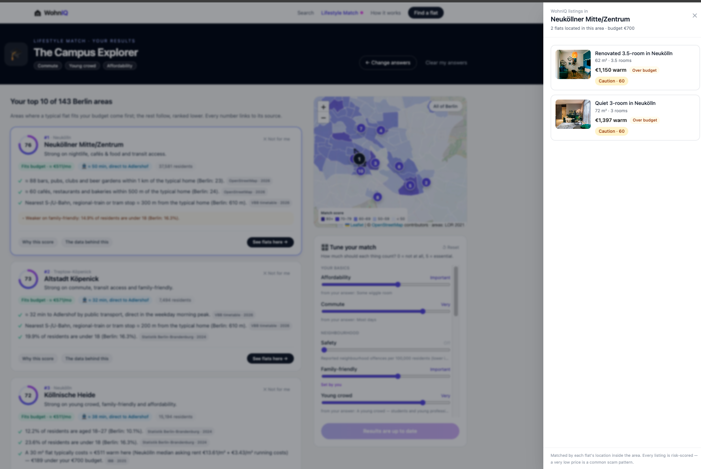

# Lifestyle Match

> Tell us how you live — we match you to Berlin neighbourhoods, explain every suggestion with the data behind it, and never store your answers.

Lifestyle Match is a questionnaire-driven way into WohnIQ. Instead of typing a query, people answer a few playful questions (or start from a preset). We predict their "lifestyle persona", let them confirm it, and rank all **143 Berlin areas** for them with a transparent, deterministic score. Every suggestion shows *why* it fits and *which publication* each number comes from. Users can re-weight, remove areas, update results and jump to WohnIQ listings located in an area.

| Entry points (homepage) | Questionnaire summary |
|---|---|
|  |  |

| Results: ranked areas, shaded map, "Tune your match" | Listings located in an area (offline demo: photo placeholders) |
|---|---|
|  |  |

Decisions: [ADR-0010](adr/0010-lifestyle-match-data-model.md) (data model & provenance) · [ADR-0011](adr/0011-lifestyle-match-scoring.md) (answers → weights → ranking) · [ADR-0012](adr/0012-privacy-by-design.md) (privacy by design).

---

## 1. User flow

1. **Homepage:** a "Try Lifestyle Match" bar under the search box, a marketing card above the feature cards, and a header link → `/lifestyle`.
2. **Welcome:** five presets (🎓 Student, 💼 Young professional, 👨‍👩‍👧 Family, 🎨 Remote/creative, 🌳 Calm & green) or "Start from scratch". A preset pre-fills answers; every answer stays editable.
3. **Four pages** (back/forward, progress bar, jump to visited steps):
   - *Your move:* budget (with cited reference figures), flat size, rooms, household, how firm the budget is.
   - *Your days:* a destination from a fixed list of 13 campuses/hubs, how often, maximum commute, work style, getting around.
   - *Evenings & weekends.*
   - *Your neighbourhood:* who's around, safety (opt-in, with a caveat), extras.
4. **Summary:** the persona ("The Campus Explorer"), the derived weights with the answer behind each, "You told us" with a *Change* link per answer, and **"Yes, that's me — show my areas"**.
5. **Results** (`/lifestyle/results`):
   - ranked area cards: score, budget/commute badges, reasons with source chips, trade-offs, *Why this score*, *The data behind this*;
   - a shaded map of all 143 areas with the top matches numbered;
   - **Tune your match** sliders with an explicit **Update results** button;
   - **✕ Not for me** with undo, and **See flats here** (side panel).

## 2. What we score (16 factors)

Research on residential choice consistently puts **cost** and **commute** first, then neighbourhood qualities: safety, quiet, green space, everyday amenities, family infrastructure, social scene and transit. The catalogue covers all of them with Berlin data.

| Factor | Measured as (per area) | Source |
|---|---|---|
| Affordability *(personal)* | typical warm rent for *your* flat size vs. *your* budget | IBB Tabellenband 2025 Tab. 25 (district median asking rent) + Betriebskostenübersicht 2026 (€3.43/m²) |
| Commute *(personal)* | door-to-door minutes from the area to your destination | VBB GTFS weekday-peak network (07:00–09:00), precomputed |
| Safety | "Kieztaten" (neighbourhood offences) per 100,000 residents, mean 2023–2025 | Polizei Berlin, Kriminalitätsatlas |
| Family-friendly | % of residents under 18 | Amt für Statistik BB, Einwohnerregister 31.12.2024 |
| Young crowd | % of residents aged 18–27 | same |
| Quiet | resident-weighted traffic-noise class | Umweltgerechtigkeitsatlas 2023/24 (noise 2022) |
| Clean air | resident-weighted NO₂/PM class | same (2023) |
| Cooler summers | resident-weighted heat-stress class | same (2022) |
| Green space | resident-weighted green-space supply class | same (2020) |
| Cafés & food · Everyday errands · Nightlife · Culture · Sport | amenities within 500 m / 1 km / 1.5 km of the typical home | OpenStreetMap (Geofabrik, 2026-11-08) |
| Water & nature | distance to the nearest lake/river/canal ≥ 1 ha or forest ≥ 5 ha | OpenStreetMap |
| Transit access | distance to the nearest S/U-Bahn, regional-train or tram stop with peak service | VBB GTFS |

"Typical home" = a 100 m grid over OSM residential land, with each planning area's registered residents spread over its grid points. Figures describe where people live, not parks or rail yards. Deliberately **not** used: nationality/migration data, and the atlas's social-disadvantage index (proxies for discrimination or stigma). The crime figure carries the police's own caveat that busy, visited areas read higher.

## 3. How the score works

All of this is deterministic code: no LLM, same input → same output.

1. **Answers → weights.** Each option sets importance levels 0–5 (shown to the user as a tooltip). Weight = the highest level any chosen answer gives an attribute. Users can override any weight on the results page.
2. **Area score per factor, 0–1.**
   - Continuous measures use fixed Berlin-wide reference points (10th/90th percentile; counts log-scaled).
   - Class measures use the class bounds.
   - Affordability and commute use `limit_score`: full marks comfortably inside your limit, half at the limit, zero well beyond it.
3. **Total** = `Σ weight × score / Σ weight` over factors with data, shown 0–100.
4. **Ranking:** areas where a typical flat fits the budget first (over-budget areas are shown, ranked lower). Then areas within your maximum commute, then the total, with ties broken by area key.
5. **Removing an area never changes any other area's score** (fixed references, independent scoring).
6. **Explanations** are templates over the same numbers. Each sentence quotes its figure and cites a source. Trade-offs (`caveats`) are kept separate from data caveats (`notes`).

## 4. Privacy by design

- **Collect less:** fixed choices and bounded numbers only, and unknown fields are rejected. Destinations are ids from a fixed list, so no address is typed, geocoded or sent anywhere. No question asks about age, gender, origin, religion, health or income.
- **Keep nothing:** `/profile` and `/match` are pure functions of the request plus read-only data, with no database access at all. POST responses are `Cache-Control: no-store`.
- **Log nothing identifying:** counts and latency only. Answers only travel in POST bodies, never in URLs. Redacted in the same change: `/search` query logging, commute-failure logs, LLM validation logs.
- **Browser:** answers live in `sessionStorage` for the current tab only, with "Clear my answers". No localStorage, cookies, URL parameters or analytics.
- **No third parties at request time:** no LLM, geocoding or transit-API calls.

## 5. Evaluation & tests

`make eval-lifestyle` (also run by `pytest`): **38 / 38 checks pass.**

| Scenario | Expectation | Top results (current data) |
|---|---|---|
| **Student preset (Definition of Done)** | top 3 include an area ≤ 20 min from TU Berlin where a 30 m² flat fits €700 warm | Schöneberg Nordwest 19 min ≈ €577 · Otto-Suhr-Allee/Kantstraße 15 min ≈ €678 · Schöneberg Nordost 25 min ≈ €577 |
| Student at HTW | top 3 within budget and the 30-min limit | Oberschöneweide 15 min · Niederschöneweide 5 min · Altstadt Köpenick 29 min |
| Family | top 5 within budget, ≥ 0.6 on family and green | Malchow · Lichtenrade Süd · Gatow/Kladow · Hellersdorf Ost · Neu-Hohenschönhausen Nord |
| Calm & green | top 5 ≥ 0.8 quiet, water/forest ≤ 600 m | Gatow/Kladow · Rahnsdorf · Köpenick Süd · Frohnau/Hermsdorf · Malchow |
| Remote / creative | top 5 ≥ Berlin-average cafés | Neuköllner Mitte · Schillerpromenade · Schöneberg Nordost · Prenzlauer Berg Süd · Helmholtzplatz |
| Young professional @ Potsdamer Platz | top 5 within 40 min and ≥ average cafés | Helmholtzplatz · Prenzlauer Berg Süd · Brunnenstraße Süd · … |
| Night owl | top 5 in Berlin's top quarter for bars, inner city | Wedding Zentrum · Karl-Marx-Allee Süd · Südliche Friedrichstadt · … |

Plus these property checks:
- **For every preset:** determinism, exclusion invariance, affordable-before-over-budget, and grounded explanations (every sentence quotes its number).
- **For 7 attributes:** monotonicity (raising a weight never pushes the best area for it down).
- **Privacy by construction:** 4 checks.

| Suite | Command | Count |
|---|---|---|
| Backend unit/API/privacy/data tests | `make test` | 346 (+1 slow full rebuild: `make test-all`) |
| Frontend logic tests (node:test, no deps) | `make frontend-test` | 34, incl. a contract test against the real catalog |
| End-to-end (Playwright, desktop + mobile) | `cd frontend && npm run test:e2e` | 5 journeys × 2 viewports |

The privacy tests send distinctive answers through every endpoint with all loggers captured and assert they appear nowhere. They were verified against a deliberately injected leak.

## 6. Data pipeline

```bash
# once: put the official files in backend/data/lifestyle/raw/ (see its README for sources)
make lifestyle-data      # ~4 min → data/lifestyle/regions.json + regions_geo.json (reproducible)
make lifestyle-fixture   # refresh the frontend's catalog contract fixture
make test-all            # includes rebuilding from raw files and diffing the result
```

The build validates every input:
- the register rows must sum to their totals;
- the environmental-atlas table has a per-row checksum;
- geometry must match the published areas;
- all joins must be complete.

It found and handled one error in the official brochure: a Charlottenburg row printed again under Steglitz. The parser skips it rather than guessing.

## 7. Known limitations

- **Rents are district medians** (12 values), shown with the district's 80% offer range. A finer model was tried and rejected as implausible (ADR-0010).
- **Environmental classes are Berlin-relative**, and the green-space data is from 2020.
- **Amenity distances are straight lines** from homes.
- **Commute is only available to the 13 listed destinations** (by design, for now).
- **The listing inventory is synthetic and small** (100 flats). Many areas show "no WohnIQ listings here yet".

## 8. Definition of Done — checklist

| Requirement | Evidence |
|---|---|
| Student preset → an area near TU Berlin within a typical student budget | Eval scenario 1: Otto-Suhr-Allee/Kantstraße (TU campus area) 15 min, ≈ €678 for 30 m² ≤ €700; Schöneberg Nordwest 19 min, ≈ €577. E2E test `Definition of Done …` on desktop + mobile |
| … with reasons | Every result carries reasons quoting figures + source chips; eval "grounded explanations"; e2e asserts reasons and source chips on the top 3 |
| Answers not stored in the DB | `/profile` and `/match` have no repository dependency (`test_stateless_endpoints_never_open_the_repository`); the listing hand-off only reads |
| Answers not logged | `test_lifestyle_answers_never_reach_the_logs` (+ `/search`, commute, LLM redaction tests); real server run: 0 occurrences in the access/app log |
| Multi-page UI with back/change, summary + persona + "did we get it right?" | `/lifestyle`; e2e walks every page, "Change" links, "Clear my answers" |
| Transparent deterministic scoring (answers → weights × profiles) | ADR-0011; determinism + monotonicity evals |
| User control: adjust weights, remove areas, update results | results page; e2e `the user stays in control` (sends only changed weights) |
| Homepage entry + marketing card | entry bar, card, header/footer links; e2e `homepage invites users …` |
